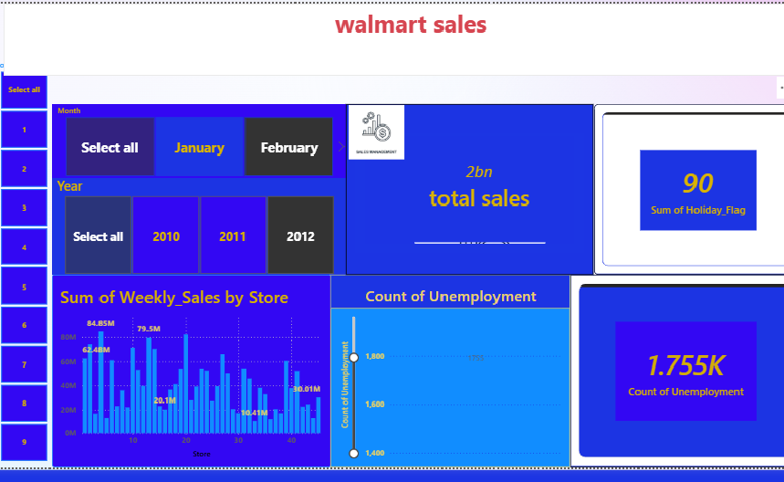

# 🔴 Walmart Sales Analysis
---

## 📊 نظرة عامة على المشروع
تحليل بيانات مبيعات شركة وولمارت باستخدام Python لتنظيف وتحليل البيانات، و Power BI لبناء Dashboard تفاعلي يستخرج أهم الـ Insights اللي تساعد في اتخاذ القرار.

### 🛠️ الأدوات المستخدمة:
- **Python**: Pandas, NumPy, Matplotlib, Seaborn
- **Power BI**: للـ Data Visualization والـ Dashboard
- **Excel**: للمراجعة الأولية للبيانات

### 📈 أهم النتائج:
1. تحديد أعلى الفروع مبيعاً
2. تحليل اتجاه المبيعات حسب الشهور والمواسم  
3. معرفة المنتجات الأكثر ربحية
4. تحليل سلوك العملاء وطرق الدفع

  ### 📊 Dashboard
  
  
  **Key Insights:** Interactive Power BI dashboard analyzing $2B+ in Walmart sales across 45 stores (2010-2012). 
  Features: YoY trends, holiday impact analysis, store performance, and unemployment correlation.
  
  **Tools Used:** Power BI | DAX | Power Query | Data Visualization

### 🔗 لينك المشروع على لينكد إن:
[اضغط هنا لمشاهدة البوست:( ### 🔗 Live Demo
[🚀 Click Here to View Interactive Dashboard](https://bit.ly/WalmartBI-Younis2026)                    )

---
Younis Elsayed | Data Analyst 

 📧 Email: mohay1758@gmail.com  
🔗 LinkedIn: [linkedin.com/in/younis-elsayed-9358b9412](https://www.linkedin.com/in/younis-elsayed-9358b9412)  

         

